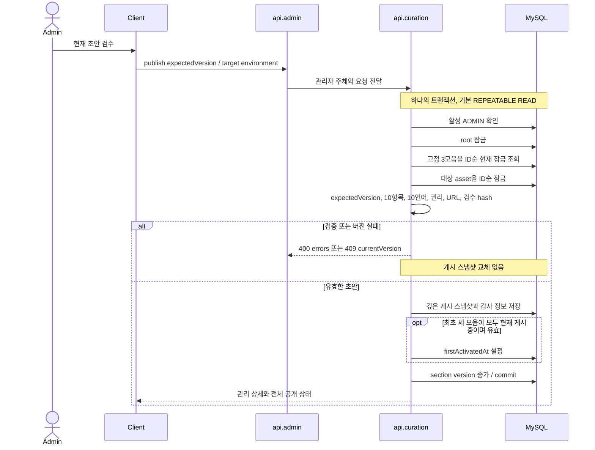
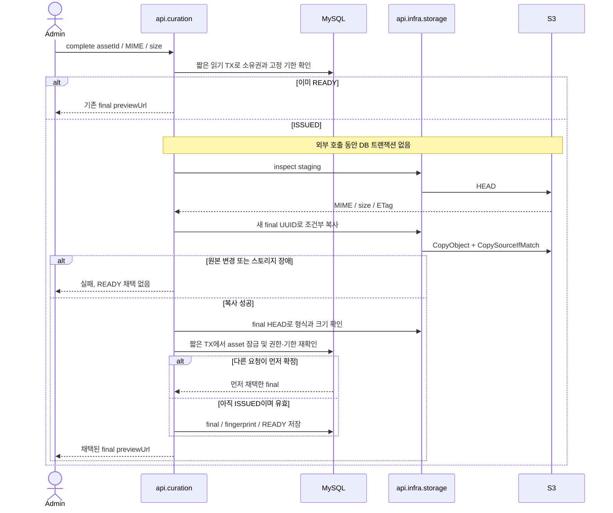

# 큐레이션 게시·사진 확정 흐름

이 문서는 기능 브랜치의 구현을 설명한다. 실제 dev/prod 기능 배포나 사진 권리 승인을 뜻하지 않는다.

## UC-1. 저장된 초안 게시

- **트리거:** 활성 관리자가 현재 version의 초안을 검수하고 publish를 요청한다.
- **사용 컨텍스트:** admin, curation. 권한·환경·내용 검증에 실패하면 기존 게시본을 유지한다.

관리자 확인이 이전 읽기 스냅샷을 만들 수 있으므로 다른 모음의 상태는 잠금 조회로 읽는다. 공개 GET은 별도 readOnly 트랜잭션에서 일관된 스냅샷을 조회한다. 최초 활성화 후 하나를 내리면 홈은 숨지만 나머지 게시 상세는 유지한다.

## UC-2. 임시 사진을 변경 불가능한 최종 사진으로 확정

- **트리거:** 발급 관리자가 staging PUT 뒤 complete를 요청한다.
- **사용 컨텍스트:** admin, curation, storage. final 경로에는 presigned PUT을 발급하지 않는다.

패자의 복사본이나 DB 채택 실패 후 객체는 미참조로 남으며 승자의 final을 삭제하지 않는다. 자동 정리 실행은 추가하지 않았다. 후속 정리는 정확한 전용 prefix, 고정 기한과 유예 기간, 초안 및 내린 게시 스냅샷의 참조 보호를 검증한 뒤 진행해야 한다.
